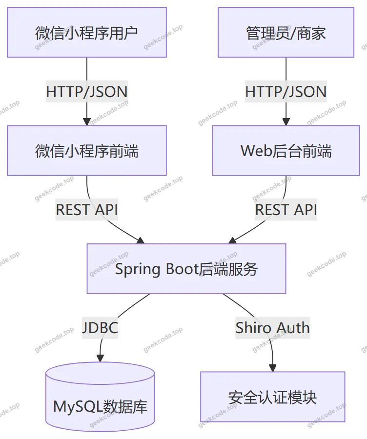
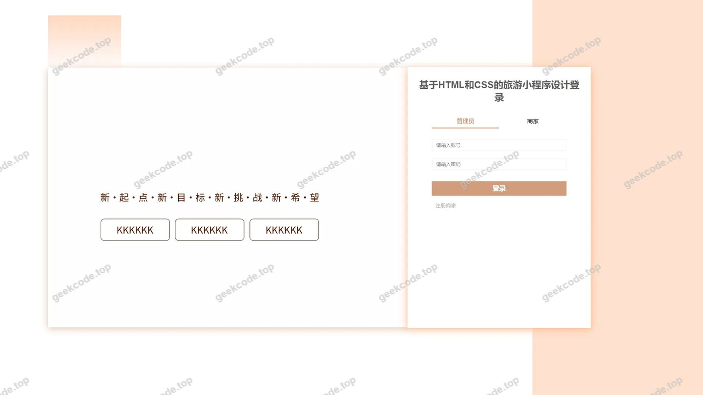

# 旅游小程序设计

> 🎓 **计算机毕业设计 · 旅游小程序设计**
>
> 本仓库只放**项目介绍 + 运行截图**（截图是站点带水印的原图，存在仓库 `images/` 里）。
>
> 👉 **完整可运行源码 / 数据库脚本 / 部署文档：[点我获取](https://geekcode.top/archives/%E6%97%85%E6%B8%B8%E5%B0%8F%E7%A8%8B%E5%BA%8F%E8%AE%BE%E8%AE%A1?utm_source=github)**
>
> 💬 咨询微信：**ir9372**　|　🌐 更多项目：[极客代码 geekcode.top](https://geekcode.top/?utm_source=github)
>
> 📌 项目详情页：<https://geekcode.top/archives/%E6%97%85%E6%B8%B8%E5%B0%8F%E7%A8%8B%E5%BA%8F%E8%AE%BE%E8%AE%A1?utm_source=github>

<table><td width="230" align="center"> <b>扫码加微信 ir9372</b></td><td valign="middle">📦 源码 = 项目介绍 + 全部运行截图 + 数据库 + 部署文档 👉 点上方任意截图，直接跳到 <b>极客代码 geekcode.top</b> 详情页</td></table>

---

<h1>旅游小程序设计</h1>
<h2>项目概述</h2>

本项目名为“旅游小程序设计”，旨在构建一个集景点展示、酒店预订、门票购买及用户互动于一体的综合性在线旅游服务平台。系统采用前后端分离架构，前端包含微信小程序用户端与 Web 后台管理端，后端基于 Java 技术栈开发。核心功能涵盖商家注册与管理、景点与酒店信息浏览、在线预订与支付流程模拟、用户评论互动以及内容资讯发布。适用人群包括普通游客（通过小程序进行消费决策）和平台管理员/商家（通过后台进行数据维护与服务提供）。项目解决了传统旅游信息分散、预订流程繁琐的问题，通过移动端便捷入口提升用户体验，同时为运营方提供高效的数据管理能力。

<h2>技术架构</h2>

系统整体架构分为表现层、业务逻辑层和数据持久层，各层之间通过 RESTful API 进行通信。

<strong>1. 前端架构</strong>

<ul>
<li><strong>微信小程序端</strong>：作为主要用户交互界面，负责渲染景点列表、酒店详情、订单页面等 UI 组件。小程序通过 HTTP 请求调用后端接口获取动态数据，实现页面跳转与状态管理。</li>
<li><strong>Web 后台管理端</strong>：基于 Vue.js 框架构建（依据 <code>vue-integrated</code> 类型推断），提供可视化的管理界面。管理员和商家通过浏览器访问后台，执行增删改查操作。</li>
</ul>

<strong>2. 后端架构</strong>

<ul>
<li><strong>框架选型</strong>：采用 Spring Boot 作为基础应用框架，利用其自动配置特性快速搭建服务；集成 MyBatis-Plus 简化数据库 CRUD 操作，提高开发效率；使用 Apache Shiro 进行安全控制，处理身份认证与权限校验。</li>
<li><strong>交互方式</strong>：后端暴露标准的 REST API 接口，接收来自小程序和 Web 前端的 JSON 格式请求，处理后返回统一格式的数据响应。</li>
</ul>

<strong>3. 数据库设计要点</strong>

<ul>
<li>基于 MySQL 关系型数据库存储核心业务数据。</li>
<li>主要实体包括：用户 (<code>yonghu</code>)、商家 (<code>shangjia</code>)、景点信息 (<code>jingdianxinxi</code>)、酒店信息 (<code>jiudianxinxi</code>)、门票购买记录 (<code>menpiaogoumai</code>)、酒店预订记录 (<code>jiudianyuding</code>)、评论信息 (<code>discuss...</code>) 及系统配置 (<code>config</code>)。</li>
<li>表结构设计中注重外键关联，确保订单与用户、商品之间的数据一致性。</li>
</ul>

<h2>功能模块</h2>

根据提供的路由配置 <code>/shangjiaCenter</code>, <code>/news</code>, <code>/jingdianleixing</code>, <code>/discussjiudianxinxi</code>, <code>/jiudianxinxi</code>, <code>/jingdianxinxi</code>, <code>/storeup</code>, <code>/shangjia</code>, <code>/jiudianleixing</code>, <code>/menpiaogoumai</code>, <code>/yonghu</code>, <code>/discussjingdianxinxi</code>, <code>/jiudianyuding</code>, <code>/config</code>, <code>/shangjiaRegister</code> 及截图信息，系统功能划分为以下模块：

<h3>1. 小程序用户端功能</h3>
<ul>
<li><strong>首页与资讯浏览</strong>：访问 <code>/news</code> 查看最新旅游资讯公告。</li>
<li><strong>景点探索</strong>：</li>
<li>浏览 <code>/jingdianxinxi</code> 获取景点详细信息。</li>
<li>通过 <code>/jingdianleixing</code> 按类别筛选景点。</li>
<li>在 <code>/discussjingdianxinxi</code> 查看并发表景点评论。</li>
<li><strong>酒店预订</strong>：</li>
<li>浏览 <code>/jiudianxinxi</code> 获取酒店详情。</li>
<li>通过 <code>/jiudianleixing</code> 按类别筛选酒店。</li>
<li>执行 <code>/jiudianyuding</code> 进行在线预订操作。</li>
<li>在 <code>/discussjiudianxinxi</code> 查看并发表酒店评价。</li>
<li><strong>门票购买</strong>：通过 <code>/menpiaogoumai</code> 模块完成景点门票的选购流程。</li>
<li><strong>个人中心</strong>：</li>
<li>访问 <code>/yonghu</code> 管理个人资料。</li>
<li>使用 <code>/storeup</code> 查看收藏的景点或酒店列表。</li>
</ul>
<h3>2. Web 后台管理端功能</h3>
<ul>
<li><strong>系统登录与安全</strong>：基于 Shiro 实现管理员登录鉴权（对应截图中的 admin 登录页）。</li>
<li><strong>商家管理</strong>：</li>
<li><code>/shangjiaRegister</code>：商家入驻注册审核。</li>
<li><code>/shangjia</code>：商家信息管理。</li>
<li><code>/shangjiaCenter</code>：商家中心，供已登录商家维护自身业务数据。</li>
<li><strong>资源信息管理</strong>：</li>
<li>景点信息 (<code>/jingdianxinxi</code>) 与类型 (<code>/jingdianleixing</code>) 的增删改查。</li>
<li>酒店信息 (<code>/jiudianxinxi</code>) 与类型 (<code>/jiudianleixing</code>) 的增删改查。</li>
<li>新闻资讯 (<code>/news</code>) 的发布与管理。</li>
<li><strong>业务数据监控</strong>：</li>
<li>门票购买记录 (<code>/menpiaogoumai</code>) 查询。</li>
<li>酒店预订记录 (<code>/jiudianyuding</code>) 查询。</li>
<li>用户评论管理 (<code>/discussjingdianxinxi</code>, <code>/discussjiudianxinxi</code>)。</li>
<li><strong>系统配置</strong>：通过 <code>/config</code> 模块设置平台全局参数。</li>
</ul>
<h2>用户角色与权限</h2>

系统主要包含三种角色，各自拥有不同的功能权限范围：

<h3>1. 普通用户 (游客)</h3>
<ul>
<li><strong>接入终端</strong>：微信小程序。</li>
<li><strong>权限描述</strong>：</li>
<li><strong>浏览权限</strong>：查看所有公开的景点、酒店、资讯信息。</li>
<li><strong>交易权限</strong>：发起门票购买申请、提交酒店预订单。</li>
<li><strong>互动权限</strong>：对景点和酒店发表评论、回复他人评论。</li>
<li><strong>个人管理</strong>：编辑个人资料、管理收藏夹 (<code>storeup</code>)。</li>
<li><strong>限制</strong>：无法进入 Web 后台，无权修改系统配置或删除他人数据。</li>
</ul>
<h3>2. 商家 (入驻商户)</h3>
<ul>
<li><strong>接入终端</strong>：Web 后台管理端 (<code>/shangjiaCenter</code>)。</li>
<li><strong>权限描述</strong>：</li>
<li><strong>注册权限</strong>：通过 <code>/shangjiaRegister</code> 提交入驻申请。</li>
<li><strong>数据维护</strong>：仅能管理归属于自己的景点或酒店信息（具体隔离策略视后端实现而定，通常商家只能编辑自己名下的资源）。</li>
<li><strong>订单查看</strong>：查看涉及自家资源的门票购买和酒店预订记录。</li>
<li><strong>限制</strong>：无系统级配置权限，无法管理其他商家的数据。</li>
</ul>
<h3>3. 系统管理员 (Admin)</h3>
<ul>
<li><strong>接入终端</strong>：Web 后台管理端。</li>
<li><strong>权限描述</strong>：</li>
<li><strong>全局管理</strong>：拥有最高权限，可访问所有后台路由。</li>
<li><strong>用户/商家管理</strong>：审核商家注册，管理用户账户状态。</li>
<li><strong>内容管理</strong>：发布新闻，删除违规评论，维护景点和酒店的分类字典 (<code>/jingdianleixing</code>, <code>/jiudianleixing</code>)。</li>
<li><strong>系统配置</strong>：修改 <code>/config</code> 中的平台参数。</li>
<li><strong>数据统计</strong>：查看所有订单和业务日志。</li>
</ul>
<h2>项目特色与创新点</h2>
<ol>
<li><strong>多端协同架构</strong>：实现了微信小程序轻量级体验与 Web 后台强大管理能力的有机结合。前端通过 REST API 与后端解耦，保证了系统的扩展性和维护性。</li>
<li><strong>精细化权限控制</strong>：引入 Apache Shiro 框架，针对管理员、商家和普通用户设计了严格的访问控制机制，保障了平台数据的安全性与隐私性。</li>
<li><strong>闭环业务流程</strong>：覆盖了从“信息浏览 -&gt; 决策对比（评论/收藏） -&gt; 在线预订/购票”的完整旅游消费链路，特别是将门票购买与酒店预订分模块处理，符合实际业务场景需求。</li>
<li><strong>模块化内容管理</strong>：将景点、酒店、资讯、评论等核心业务对象独立建模，支持灵活的内容检索与分类展示，提升了用户的信息获取效率。</li>
</ol>
<h2>部署环境</h2>

为确保系统正常运行，需准备以下软件环境：

<ol>
<li><strong>Java 运行环境</strong>：JDK 1.8 或更高版本（推荐 JDK 1.8，以兼容 Spring Boot 及 MyBatis-Plus 稳定版）。</li>
<li><strong>数据库</strong>：MySQL 5.7 或 MySQL 8.0+，需创建对应的数据库实例并导入初始化 SQL 脚本。</li>
<li><strong>后端构建工具</strong>：Maven 3.6+，用于依赖管理和项目打包。</li>
<li><strong>前端构建环境</strong>：Node.js 14+ 及 npm/yarn，用于编译 Vue 前端代码（若后端直接托管静态资源则仅需编译后部署）。</li>
<li><strong>小程序开发工具</strong>：微信开发者工具，用于调试和预览微信小程序前端代码。</li>
<li><strong>服务器操作系统</strong>：Linux (CentOS/Ubuntu) 或 Windows Server，建议 Linux 以获得更好的性能与稳定性。</li>
</ol>
<h2>五、技术特性</h2>
<ul>
<li>前后端集成部署，前端资源打包至后端 static 目录</li>
<li>使用 MyBatis-Plus 简化数据访问层开发</li>
<li>集成 Shiro 权限框架实现角色权限控制</li>
</ul>
<h2>六、功能模块截图</h2>
<h3>后台管理端</h3>
<h4>后台-登录页</h4>

---

## 获取完整源码

| 项目 | 说明 |
| --- | --- |
| 项目名 | 旅游小程序设计 |
| 运行截图 | 本文 2 张（站点带水印原图，仓库 `images/` 目录） |
| 完整源码 | [https://geekcode.top/archives/%E6%97%85%E6%B8%B8%E5%B0%8F%E7%A8%8B%E5%BA%8F%E8%AE%BE%E8%AE%A1?utm_source=github](https://geekcode.top/archives/%E6%97%85%E6%B8%B8%E5%B0%8F%E7%A8%8B%E5%BA%8F%E8%AE%BE%E8%AE%A1?utm_source=github) |
| 咨询微信 | **ir9372**（备注：jingpin-yuanma） |
| 更多项目 | [极客代码 geekcode.top](https://geekcode.top/?utm_source=github) |

> 需要源码、部署、改配置、跑不起来等问题，加微信 ir9372 沟通，说明项目名即可。
